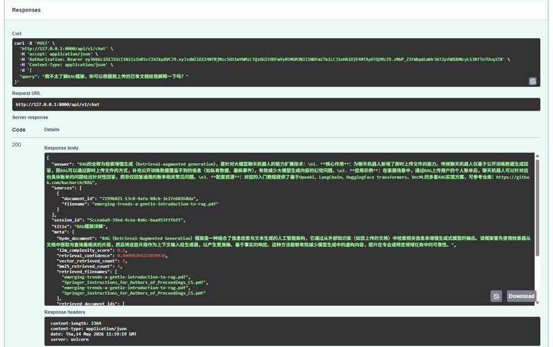

# VaultMind

VaultMind is a technical-document RAG backend built with FastAPI. It is designed to ingest user documents, index them into a per-user knowledge base, and answer questions through a retrieval-augmented chat workflow. The system combines HyDE query expansion, hybrid retrieval, and multi-model routing so responses can stay grounded in source documents while adapting to query difficulty and retrieval confidence.

## What It Does

- User authentication with JWT-based access tokens
- Document upload, storage, status tracking, and deletion
- Support for common technical formats including `md`, `html`, `pdf`, `txt`, `doc`, `docx`, `png`, and `jpg`
- Per-user vector storage powered by Chroma
- Hybrid retrieval using dense vectors plus BM25 with reciprocal rank fusion
- HyDE-based query expansion for better document recall
- Dynamic generation model routing based on query complexity and retrieval confidence
- Chat sessions with persisted messages and cited document sources

## How It Works

1. A user uploads documents, which are saved on disk and embedded into a user-scoped Chroma collection.
2. When a question arrives, the system can generate a hypothetical answer document with HyDE and estimate query complexity in parallel.
3. It retrieves context with both vector search and BM25, then merges the results with reciprocal rank fusion.
4. The router selects an appropriate generation model from the configured model set.
5. The final answer is returned as structured JSON together with source metadata.


## Stack

- FastAPI
- SQLModel
- Chroma
- LangChain
- JWT authentication
- Pluggable model providers configured through `rag_config.json` and `.env`

## Install

From the project root, using Python 3.12:

```bash
python -m pip install -r requirements.txt
```

For Word documents and images, also install the loader extras:

```bash
python -m pip install 'unstructured[doc,image]'
```

Image OCR also needs Tesseract installed on the system. The experiment scripts additionally need `pandas`, `requests`, and `tqdm` (`python -m pip install pandas requests tqdm`).

## Configuration

Runtime settings are loaded from:

- `.env` for database paths, token secrets, and provider API keys
- `rag_config.json` for provider definitions, model selection, retrieval settings, HyDE, and routing options

## API Overview

- `POST /api/auth/register`
- `POST /api/auth/token`
- `POST /api/documents/upload`
- `GET /api/documents`
- `DELETE /api/documents/{doc_id}`
- `POST /api/chat`
- `POST /api/chat/{chat_session_id}`

## Tests

## Notes

The implementation is intentionally modular: document ingestion, retrieval, routing, and generation are separated into dedicated services so the pipeline can be tuned or replaced without rewriting the API layer.
